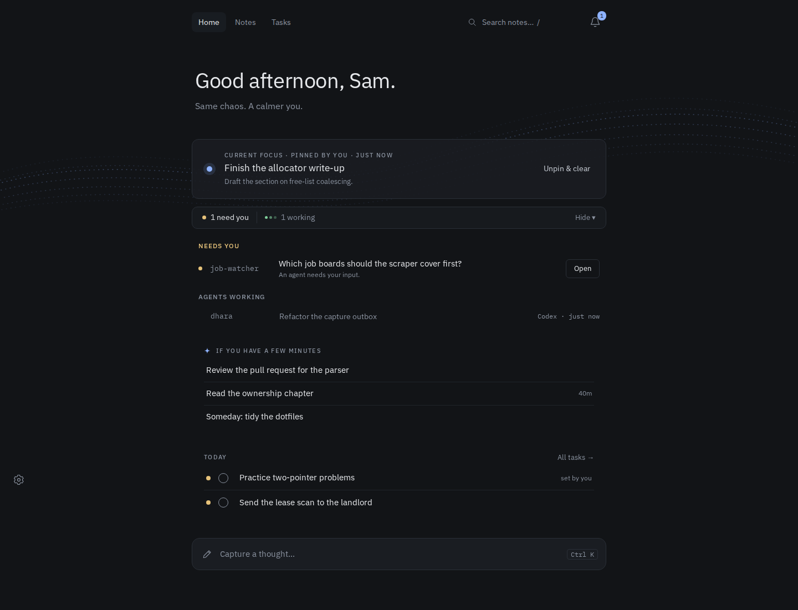
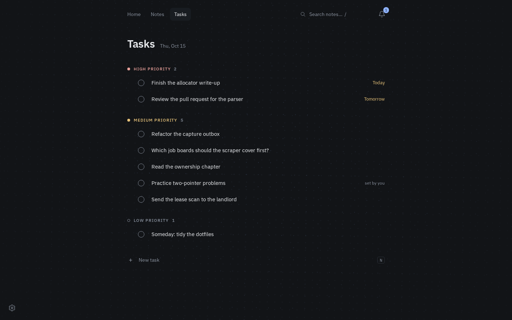
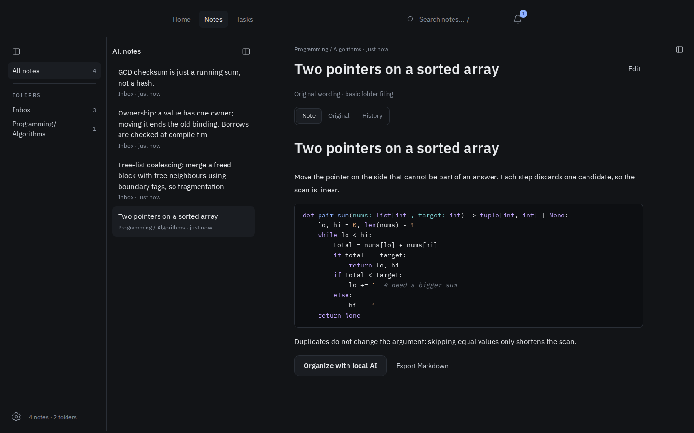
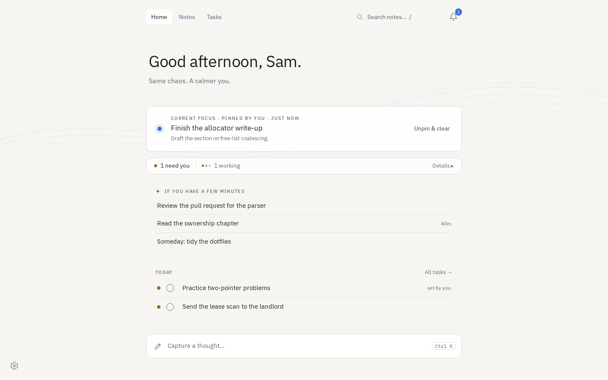
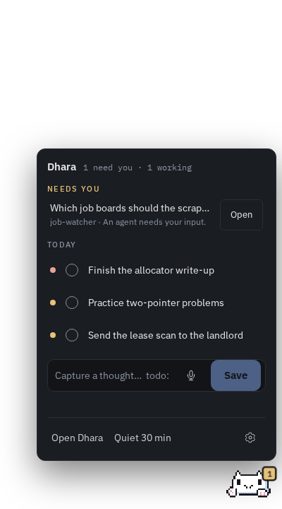
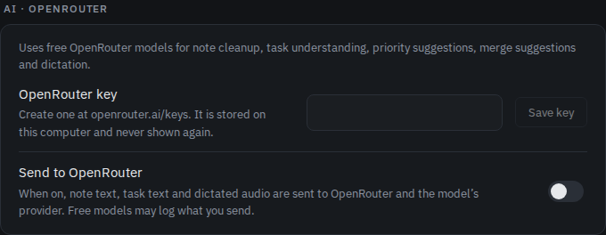

# Dhara

**धारा, "stream".** A quiet local place for what you are learning, what your coding agents are doing, and what you can do next.

Dhara keeps notes, tasks, reminders and agent activity in one SQLite workspace on your own machine. It runs as a small Python service with a React interface, in a browser or in an Electron desktop app with a pixel kitty that sits in the corner of your screen.



Version 0.1.0 is a runnable local release, not a mockup. Everything you see is backed by the real API. It starts empty; the content in these screenshots is demo data.

**No account, GPU, API key or model is needed.** AI features are optional and off by default. Nothing records your microphone, captures your screen, downloads a model or contacts an AI service unless you turn it on.

## Contents

- [What it does](#what-it-does)
- [Install and run](#install-and-run)
- [First five minutes](#first-five-minutes)
- [Desktop kitty](#desktop-kitty)
- [Optional AI (OpenRouter free models)](#optional-ai-openrouter-free-models)
- [Optional local models](#optional-local-models)
- [Connect Claude Code or Codex](#connect-claude-code-or-codex)
- [Your data](#your-data)
- [Development](#development)

## What it does

| | |
|---|---|
| **Home** | Your current focus, agents that need you (in a collapsible panel), a short list of things you can do in a few minutes, and tasks due or planned for today. |
| **Tasks** | Grouped by priority: High, Medium, Low, then Later and Done today. Drag a task to reorder it or move it to another priority. Automatic priority explains itself: "Auto · rules", "Auto · AI" or "Set by you". |
| **Notes** | Folders, list and note side by side, in resizable panes. Code blocks are highlighted. Every edit is a revision; the original capture is kept. |
| **Capture** | Press **Ctrl K** for a thought: text, pasted or dropped images, a sketch, or a voice recording. Drafts stay in the browser until the server has them. |
| **Agents** | One-click hooks for Claude Code and Codex. Each session becomes a task; the app shows when it is working, needs your input, or has a result to review. |
| **Reminders** | Scheduled, snoozable, and processed even after a restart. |
| **Desktop** | Electron shell, a Linux AppImage, and an always-on-top kitty companion. |
| **Themes** | Dark, light or system. IBM Plex fonts are bundled. |

<table>
<tr>
<td width="50%"></td>
<td width="50%"></td>
</tr>
<tr>
<td align="center">Tasks, grouped by priority</td>
<td align="center">Notes, with highlighted code</td>
</tr>
</table>



## Install and run

### Linux AppImage

Build it once with `make appimage` (or `release/build.sh`), then run `release/out/Dhara-0.1.0-x86_64.AppImage`. It starts its bundled service on `~/.local/share/dhara/workspace` (`$XDG_DATA_HOME` is respected). Useful flags: `--data-dir PATH` for another workspace, `--server URL` to use a service you started yourself.

The app never runs without Chromium's sandbox. If your system has no user namespaces and no root-owned sandbox helper, it copies the helper to `~/.local/share/dhara/chrome-sandbox`, prints the `sudo chown root:root … && sudo chmod 4755 …` command to run once, and exits. On a home mounted `nosuid`, install the helper as `/opt/google/chrome/chrome-sandbox` instead. The AppImage runs only for the user who built it; anyone else runs `--appimage-extract` and starts `squashfs-root/AppRun`.

### From source (Linux, macOS)

You need Python 3.11+ ([uv](https://docs.astral.sh/uv/) installs 3.12 for you) and Node 22 (see `.nvmrc`).

```bash
uv sync
npm --prefix web ci
uv run run.py --open      # http://127.0.0.1:8765 in your browser
```

`run.py` rebuilds the interface whenever `web/dist` is missing or older than `web/src`; pass `--no-build` to skip that. Stop the server with Ctrl-C; the next start opens the same workspace. Only one service can use a workspace at a time.

To run the Electron app against a service that is already running:

```bash
npm --prefix electron ci
node electron/scripts/link-sandbox.mjs
npm --prefix electron start -- --server http://127.0.0.1:8765
```

To let Electron start and stop the service itself (Linux only): `npm --prefix electron start -- --manage-service --data-dir /absolute/workspace`.

### Windows (PowerShell)

```powershell
uv sync
npm --prefix web ci
uv run run.py --open
```

There is no Windows installer, macOS app bundle or Android app yet; run those from source. Only Linux has been tested.

## First five minutes

1. Press **N** anywhere and type a task. Without AI, only explicit lines such as `plan: today` or `next action: …` are read, and anything uncertain stays in the original text for you to confirm. With AI on, due dates, estimates and projects are filled in from plain words. Priority stays automatic unless you set it.
2. Open **Home**. Pin a task as your focus. The few-minutes list only offers work that is actually available: nothing blocked, parked, waiting on an agent or starting later.
3. Press **Ctrl K** and dump a thought, a screenshot or a sketch. **Save note** files it.
4. Open **Notes** (or press **/** to search). Resize the panes by dragging or with the arrow keys; hide each with **Ctrl 1/2/3**.
5. In **Settings** (the gear, bottom left), connect Claude Code or Codex, pick a theme, and decide whether you want AI.

Notes never become tasks on their own, and linking a note to a task is optional.

## Desktop kitty



The desktop app opens a small transparent, always-on-top window in the bottom-right corner of your screen with a pixel loaf cat in it. The kitty shows what matters most right now, in this order: Dhara is offline, something needs you, a reminder is due, agents are working, you are focused, or nothing (it sleeps).

- **Hover** to pet it: happy eyes, a purr, a few hearts.
- **Click** for the mini panel: what needs you, due reminders (snooze +20 min), today's tasks, and a capture box. Start a line with `todo:` to make a task instead of a note. The mic records a voice note, or dictates into the box when AI is on.
- **Quiet 30 min** calms it down. **Settings → Companion** switches between Cat, Dot and Hidden.

Start the shell without it with `--no-companion` (`run.py --desktop` does not pass this flag through). Wayland compositors ignore window placement; on Sway, add:

```
for_window [title="^Dhara companion$"] floating enable, sticky enable, border none
```

An older native GTK companion for Sway, `tools/sway_companion.py`, still exists. It needs an observer token from Settings, plus PyGObject, GTK 3 and GtkLayerShell from your distribution. With `--observe-window-context` it also reports the focused window's app and title, so rules in Settings can infer your focus (no screenshots, keystrokes or clipboard).

<br clear="right">

## Optional AI (OpenRouter free models)



AI is **off by default**. When you turn it on, the text of your notes and tasks, and dictated or voice-note audio, is sent to [OpenRouter](https://openrouter.ai) and the model's provider. Free models may log what you send.

1. Create a free key at openrouter.ai.
2. In **Settings → AI · OpenRouter**, paste it and **Save key**. It is stored in the workspace as `openrouter.key` (mode 0600) and never shown again, only its last four characters. `DHARA_OPENROUTER_API_KEY` overrides a saved key.
3. Switch on **Send to OpenRouter**, then pick a text model and a dictation model. The list is OpenRouter's free models from the [models.dev](https://models.dev) catalog. The defaults are `openrouter/free` and `thinkingmachines/inkling-small:free`.

What it adds:

- **Note cleanup and filing.** An editable cleaned-up note; the original is kept.
- **Task understanding.** Fills in due date, planned day, estimate and project from what you typed, never overwriting a field you set.
- **AI priority** ("Auto · AI"), with a reason. Deadlines and blocking tasks still win, and your own choice always wins.
- **Merge related jots.** Suggests folding a short note into a related one. A merge can be undone for 24 hours, until the target note is edited.
- **Dictation** from the kitty's mic.

Free models have daily request limits. A rate-limited job retries after ten minutes, and the rules stay in charge meanwhile. Model output can be wrong; every AI change is labelled and editable.

## Optional local models

Both of these stay on your machine.

**Note cleanup with Ollama.** Run [Ollama](https://ollama.com) yourself, then point Dhara at a model:

```bash
ollama pull qwen2.5:3b
DHARA_MODEL=qwen2.5:3b uv run run.py --open
```

Dhara processes one job at a time, sends at most 14,000 characters, and asks Ollama to unload the model afterwards. A model on another host also needs `DHARA_ALLOW_REMOTE_MODEL=1`, because your notes would leave the machine. While OpenRouter AI is on, it is used instead.

**Speech transcription with faster-whisper**, on the CPU:

```bash
uv sync --extra speech
uv run tools/download_speech_model.py base.en
DHARA_SPEECH_MODEL="$PWD/.data/models/whisper-base.en" uv run run.py --open
```

Recordings are saved first and transcribed afterwards; a failure never loses the audio, and a note's **Transcribe recording** button retries. The packaged app and Electron's managed mode do not pass `DHARA_SPEECH_MODEL` through, so use a source install for this. Transcription quality on your voice and vocabulary has not been measured; try it on short recordings first.

## Connect Claude Code or Codex

Open **Settings → Connect your agents** and click **Connect Claude Code** or **Connect Codex**. Dhara adds lifecycle hooks to that agent's configuration, keeping your other settings and backing up the original. Claude Code picks them up in a new session; in Codex, open `/hooks` once and trust them.

After that, every session registers itself, with no task IDs or tokens. Each session gets a task named after the agent, project folder and a short code, such as `Codex · myrepo · 3fa9c1`. Prompts and tool use mark it working, permission requests mark it as needing you, and a finished turn becomes a result to review. A finished turn never marks a task done.

Only a hashed session ID, the agent name, the project folder's name, a status and a timestamp are recorded. No prompts, responses, transcripts or files. Events queue locally while Dhara is closed and arrive when it starts. **Disconnect** removes only Dhara's hooks. **Use plugin instead** switches to a local plugin package, if you prefer one.

The AppImage cannot host agent connections yet (the hooks need `python3` and a receiver the frozen service does not bundle), so use a source install for this.

### Wrap any command

For other tools, create a task-scoped token in **Settings → Advanced: agent & observer tokens**, copy the task ID from the task's **Connect an agent** section, and wrap the command:

```bash
export DHARA_TOKEN='paste-the-token'
python tools/agent.py --task TASK_ID --name 'Coding agent' -- your-command arg1
```

The wrapper reports liveness every 30 seconds and the exit status. A zero exit means "ready for review", not "verified". Events go through a local SQLite outbox; `python tools/agent.py --flush` replays them after an outage. The wrapper strips `DHARA_TOKEN` from the child's environment.

## Your data

- The workspace is `--data-dir`, else `$DHARA_DATA_DIR`, else `.data` beside `run.py`. Use `--data-dir "$HOME/.local/share/dhara/workspace"` to share one notebook with the AppImage.
- It holds `dhara.sqlite3`, `attachments/`, `admin.token` and, if you saved one, `openrouter.key`. Keep it private; it is not encrypted at rest.
- **Settings → Export notes & tasks** downloads a ZIP of JSON, Markdown, originals, revisions and attachments. Tokens are excluded. There is no one-click import yet.
- For a full backup, stop the server and copy the whole workspace directory.
- Browser drafts and the capture outbox live in that browser's storage. Clearing site data deletes captures that have not reached the server yet; failed uploads wait in **Captures on this device**.
- Dhara binds to localhost. Binding elsewhere requires `DHARA_ACCESS_TOKEN` and `DHARA_ALLOWED_HOSTS`, but that is a guard, not a deployment recipe: there is no supported way to expose it to the internet or sync two machines yet.

## Development

```bash
uv sync --extra test
uv run pytest                    # Python tests
npm --prefix web test            # web unit tests
npm --prefix web run e2e         # Playwright against a real run.py on a temporary workspace
npm --prefix electron test       # Electron build, unit tests and end-to-end tests in a private headless Sway (needs sway)
```

To regenerate the README images: `npm --prefix web run build && DHARA_SCREENSHOTS=1 npm --prefix web run e2e -- screenshots.spec.ts`.

Install Playwright's Chromium once with `npm --prefix web exec -- playwright install chromium`. End-to-end tests never touch your workspace.

```text
run.py              Launcher: rebuilds a stale UI, serves the API and web/dist
dhara/              Python service: server.py (API), store.py (SQLite and priority rules),
                    worker.py (background jobs), ai.py and ai_jobs.py (OpenRouter),
                    task_capture.py (rule-based parsing), agent_*.py (agent hooks)
web/                React + TypeScript interface; web/e2e holds the Playwright tests
electron/           Desktop shell, managed service mode and the companion window
release/            AppImage build: build.sh, PyInstaller spec, launcher
tools/              agent.py (command wrapper), sway_companion.py, sway_context.py,
                    transcribe.py, download_speech_model.py, doctor.py (setup diagnostics)
tests/              Python tests
docs/screenshots/   README images (web/e2e/screenshots.spec.ts)
```

Dhara was previously called Noema. Existing workspaces, tokens and settings from that name are still read for one release.
