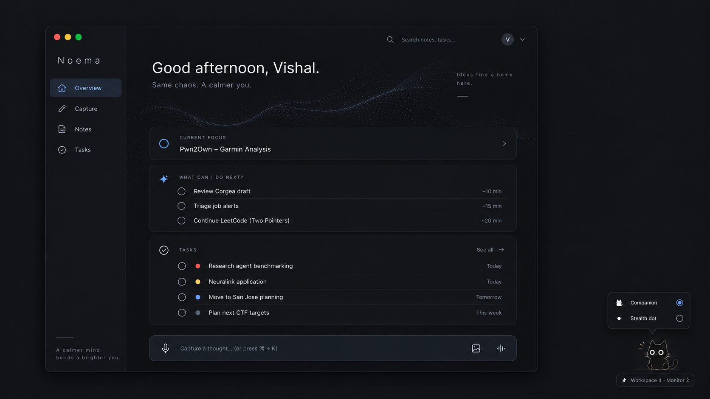
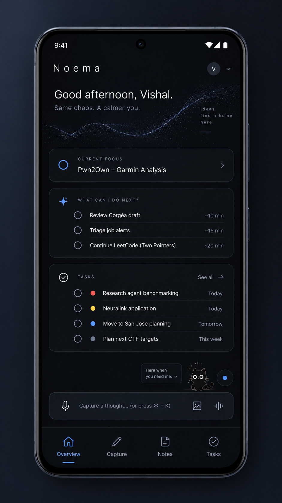
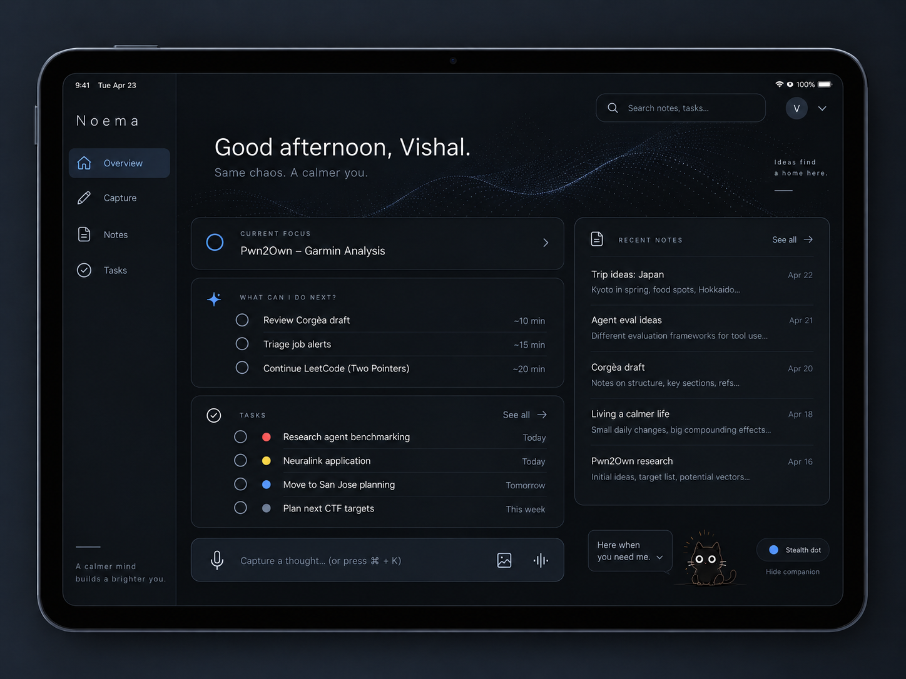
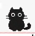
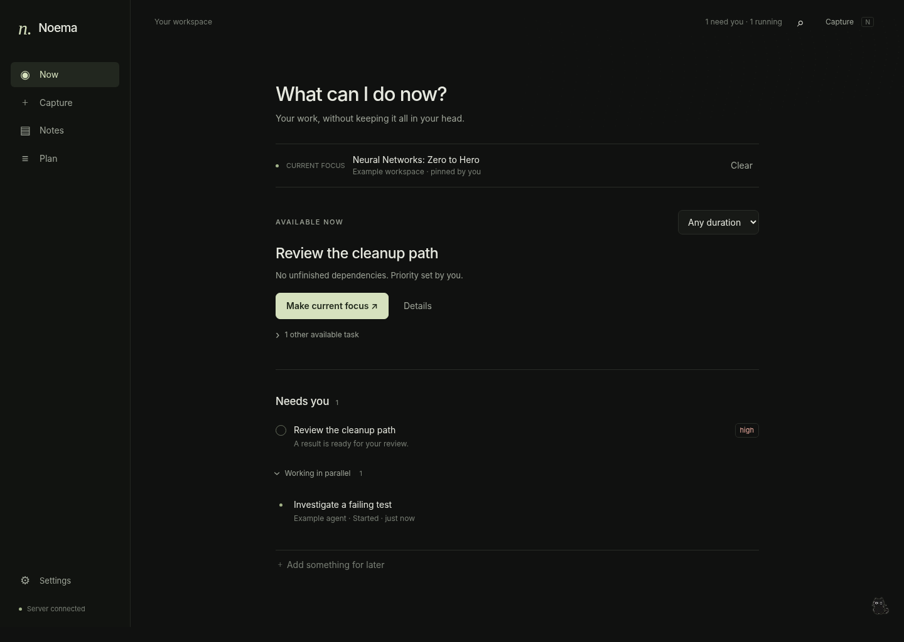

# Noema — Product & Engineering Handbook

**Documentation revision 1.0 · 8 October 2026**

Prepared for Vishal Juneja. Source coverage: v0.1.0 baseline and recovered v0.2.0.

## Contents

- [Read this first](#guide)
- [01 / What Noema is built for](#purpose)
- [02 / Scope and boundaries](#scope)
- [03 / The daily-use workflows](#journeys)
- [04 / Capture and the learning notebook](#capture)
- [05 / Voice and visual thinking](#voice)
- [06 / Organization, retrieval and knowledge ownership](#organization)
- [07 / Tasks, runs and current focus](#tasks)
- [08 / “What can I do now?” and priorities](#next)
- [09 / Agents, reminders and future planning](#agents-reminders)
- [10 / UI direction and navigation](#ui-rules)
- [11 / Desktop design reference](#desktop)
- [12 / Mobile design reference](#mobile)
- [13 / Tablet design reference](#tablet)
- [14 / Capture, Notes and Plan interaction design](#capture-ui)
- [15 / The cat, the dot and multiple monitors](#companion)
- [16 / Screen awareness: design and current code](#screen)
- [17 / Privacy, permissions and trust](#privacy)
- [18 / Architecture: what exists and what is proposed](#architecture)
- [19 / Data, state and integration contracts](#data)
- [20 / Devices, offline use and synchronization](#platforms)
- [21 / Compute and resource policy](#compute)
- [22 / What has actually been built](#inventory)
- [23 / Verification and the implemented interface](#verification)
- [24 / Roadmap and release gates](#roadmap)
- [25 / Future plans and unresolved implementation work](#backlog)
- [26 / Acceptance checklist for the intended product](#acceptance)
- [27 / Decisions, risks and open choices](#decisions)
- [28 / Running, backing up and continuing development](#operations)
- [29 / Sources, assets and maintenance](#sources)

<a id="guide"></a>
# Read this first

**Noema is an intelligent learning-notebook and to-do system for parallel human and agent work.** Its central question is: **“What can I do now?”** It should preserve knowledge, track commitments and recover context without becoming another system that needs constant maintenance.

This handbook consolidates the agreed product and interface direction, the source that actually exists, and the work that remains. It is documentation, not a new application release. No application source was changed, no model was downloaded, and nothing was installed on the user's laptop while preparing it.

## Documentation baseline
| Item | Baseline |
|---|---|
| Owner and primary user | Vishal Juneja; security engineering, CTFs, coding, learning and applications |
| Date / handbook revision | 8 October 2026 / documentation revision 1.0 |
| Target hardware | Intel Core i7-1270P, 32 GB RAM, integrated Intel graphics |
| Platform goal | Linux, Windows, macOS and Android; responsive phone and tablet layouts |
| Previously linked build | Noema v0.1.0: local runnable baseline |
| Newest recovered source | Noema v0.2.0: adds experimental Sway screen awareness |

**Version correction:** the preceding status update described v0.1.0. Preparing this handbook also located a v0.2.0 archive in the Library. Both are documented. The newer archive is not evidence of an installed, deployed or hardware-validated application. Its screen-awareness code exists; reliable understanding of the user's real screen has not been demonstrated.

## How to read status labels
**Implemented** means code is present in the inspected archive. **Verified in tests** means the stated test boundary was exercised. **Device-unvalidated** means actual OS, browser, microphone, compositor or model behavior still needs testing. **Planned** means part of the intended product but not delivered. **Proposed** identifies a technical choice or milestone sequence that still needs confirmation through implementation.

**Source checks performed for this handbook:** both ZIPs passed integrity checks; all 47 manifest entries in v0.1.0 and 57 in v0.2.0 matched. The recovered v0.2.0 Python suite was rerun in this container: **125 passed in 8.10 seconds**. Historical browser checks and resource measurements are cited as recorded results, not new device tests.

Source: [C], [V1-STATUS], [V2-STATUS], [DOC-QA], [HASH].


<a id="purpose"></a>
# 01 / What Noema is built for

The problem is not simply a long to-do list. Several contexts are active at once, and each has different thoughts, prompts, notes, results and unfinished decisions. Switching between them forces the user to remember what was happening, what an agent is waiting for, and where to resume.

The original example is a Sway desktop with separate workspaces for internship work, general browsing and AI conversations, LeetCode or competitive programming, job applications, and Andrej Karpathy's Neural Networks: Zero to Hero course. Noema sits above those contexts. Sway is an integration, not the organizing model.

## Two connected responsibilities
**Knowledge:** capture what the user learns, observes, tries, suspects or figures out. A rough explanation of a pwn challenge, an interpretation of a decompiled function, or a small algorithm trick should become a useful note in the right folder.

**Attention:** track what the user intends to do, which agents are working, what needs a decision, what is waiting, and which existing task can be acted on now. A result should arrive with enough context for review, not just a notification that a process stopped.

A note may link to a task, but neither requires the other. “I am not sure why this works” is knowledge, not automatically an obligation. An agent finishing is evidence about its run, not proof that the desired outcome is complete.

## The product promise
The user should be able to leave an agent working, study something else, capture a thought from a phone, and later recover the correct task, unresolved concern and source material. The goal is lower cognitive overhead, not maximizing simultaneous work or keeping the user permanently occupied.

## Measures of success
Measure whether the user can resume without reconstructing context, capture without choosing folders, find a previously learned trick, and trust task state. Evaluate correction burden, distracting interruptions, lost captures and resource overhead during real work.

Proposed evaluation: use a week of ordinary work and record the cases where Noema saved a context reconstruction, missed a commitment, misfiled a note or suggested the wrong task. Do not replace these observations with a productivity score or a count of tasks completed.

Source: [C]. These are agreed goals; no user-outcome study has been performed.


<a id="scope"></a>
# 02 / Scope and boundaries

## In the intended product
| Capability | Required behavior |
|---|---|
| Frictionless capture | One space for rough text and speech, with images and sketches in the same capture |
| Learning notebook | Meaning-preserving cleanup, sensible ordering, automatic folders and original recovery |
| Attention management | Current focus, running work, requests needing the user, waiting work and available next actions |
| Planning | Future to-dos, dependencies, reminders, automatically assigned priorities and persistent manual overrides |
| Agent context | Integration events where available; attached links and explicit updates elsewhere |
| Screen context | Optional, permission-scoped observation that can suggest or update focus without claiming completion |
| Companion | Tiny illustrated black cat, resizable or collapsible to a dot, located on the observed monitor/workspace |
| Portability | Shared notes and task context across desktop, phone and tablet; cloud synchronization is a product goal |
| Efficiency | CPU-first operation; no mandatory GPU, paid model API or permanently resident model |

## Explicit non-goals for the initial product
Noema is not an autonomous operator that buys services, submits applications, executes arbitrary commands or approves agent output. It does not replace the user's coding agents, reverse-engineering tools, browser, notebook runtime or IDE. It is not an employer-surveillance product or a continuous video archive of the desktop.

It should not implement every project-management feature, a giant customizable dashboard, social productivity feeds, streaks, a general workflow-builder platform or a multi-user enterprise control plane before the personal workflow works. Full desktop/window restoration is not required for useful context recovery.

A paid subscription and a rented GPU must not be prerequisites. Self-hosting can still incur storage, electricity or hosting costs. Noema's compute budget is separate from the agents, fuzzers and builds it tracks.

## Scope discipline
The cross-platform and cloud goals remain in scope even though the current release is local. Conversely, a generated interface picture does not establish that its features are implemented. Do not expand into calendar integration, semantic search or automatic agent launching merely because a screen has spare space.

New proposals should identify the user problem, data accessed, resource cost, failure behavior and an acceptance test before entering the active milestone. Preserve the simple daily loop: capture, work, review and resume.

Source: [C]; current delivery boundaries: [V2-STATUS].


<a id="journeys"></a>
# 03 / The daily-use workflows

## Security / CTF learning
While investigating a challenge, the user types or says: “Changing the size did not help. Delete may free the chunk but leave the slot pointing at it. Not confirmed. Need to check show.” A sketch of the slot and chunk is added while talking. Saving creates a learning note, not a confirmed vulnerability report or an automatic reminder.

The organized note groups the attempted approach, hypothesis and open question, preserves the original, and files it with the challenge. “May leave the pointer” must not become “Found a use-after-free.” A later correction creates an updated note without destroying the earlier reasoning.

## LeetCode / algorithms
A rough capture says: “Sorted input. Two pointers. Sum too small, move left forward; too big, move right back. Forgot sorting mattered.” The saved note retains the technique and the assumption the user overlooked. It can link to the problem. A two-line insight should not be inflated into a generic textbook chapter.

## Parallel agent work
The user assigns work to an integrated agent and changes context. A task records the desired outcome; a run records that particular attempt. Agent events update the run. If it asks a question, the task is surfaced in Needs you. When it finishes, the result is ready for review, not automatically accepted.

While the run is active, “What can I do now?” selects another existing, unblocked task. It does not invent busywork or estimate how soon the agent will finish. Returning to the original task exposes the goal, last concern, result/session link and next action.

## Voice plus a visual
The user starts recording, pauses to think, types a function-name correction, drops a screenshot and draws an arrow. These are parts of one explicit capture. The target experience links visuals to the relevant recording passage; current releases retain the bundle but do not implement those time links or live transcription.

## Cross-device continuation
The intended workflow allows a desktop task, a phone capture and a tablet review to use the same persistent context. Offline content is visibly local until synchronized. This is an acceptance target, not a current cloud capability: separate local installations do not yet reconcile their data.

Source: [C]. Examples are illustrative, not claims about current user activity. Delivery limits: [V2-STATUS].


<a id="capture"></a>
# 04 / Capture and the learning notebook

## Input contract
Open Capture and write or record without a mandatory title, project, folder, template or tags. Grammar, sentence completeness and ordering are not the user's responsibility. The page should accept disconnected fragments, self-corrections, code blocks, commands and identifiers without continually restructuring the draft.

**Explicit Save is the notebook boundary.** The app may preserve a local draft for recovery, but it must not silently turn screen observations, conversations or every microphone fragment into permanent learning notes. Organization can run after saving; a model failure must not prevent the original from being stored.

## Interpretation contract
Clean grammar, group related fragments, remove filler and arrange material logically. Preserve uncertainty, negation, numeric values, identifiers, assumptions, failed attempts and distinctions between observations and hypotheses. Do not fill missing reasoning with a plausible explanation. An incomplete thought remains an incomplete thought.

An explicit correction can replace the interpretation in the organized view; unresolved contradictions should remain visible. Reordering must not turn a later hypothesis into an earlier verified observation or erase the chronology of an investigation.

## Stored views
**Organized** is the editable reading version. **Original** holds the captured wording and original transcript separately. **History** lets the user inspect and restore revisions. A restore creates a new revision rather than erasing newer history. A model result that arrives after a manual edit must be a suggestion, not a silent overwrite.

One capture can contain text, audio, screenshots and sketches. Splitting a mixed-topic capture into multiple notes is planned; all resulting notes must remain traceable to the same original. An uncertain classification belongs in Inbox, with an easy correction path.

## Current implementation
The releases persist explicit multimodal captures, originals, attachments and revisions. Conservative keyword rules assign folders without a model. Optional local Ollama processing can produce the cleaned-up body. **No model means no grammar/flow rewrite.** Shape validation does not prove a model preserved meaning.

Capture IDs and content fingerprints make matching upload retries idempotent. Reusing an ID for changed content is rejected. Optimistic versions detect edit conflicts. Real browser storage durability and full model quality still need device testing.

Source: [C], [V2-ARCH], [V2-README], [V2-TEST].


<a id="voice"></a>
# 05 / Voice and visual thinking

## Voice is thinking aloud, not polished dictation
The recording interface must accommodate hesitation, unfinished sentences, long pauses, restarts and “no, that is wrong.” Provide clear start, pause, resume and stop controls. Quiet recording and a transcript view are target options; the user should not be forced to monitor live text while reasoning.

Recording, transcription and note organization are different steps. Save the original audio, transcribe it, then organize the result. A typed correction such as an exact function name belongs to that capture. Technical identifiers, hexadecimal values, acronyms and negation need particular care; low-confidence terms should be reviewable against the audio rather than silently replaced.

## A small visual space in voice mode
Keep a compact visual tray beside or below the recording area. It accepts pasted images, screenshots, uploaded images, photos and lightweight sketches. It should remain usable while recording. The tray is not a full design tool or a large permanent attachment manager.

The target sketch controls are pen, eraser, undo and a simple text tool. A heap layout, call-flow arrow, array/pointer sketch or dry-run table should take seconds to add. Original visuals remain available even if the app later captions, indexes or interprets them.

Add a timestamp when a visual is inserted; later, selecting it should optionally jump to the related audio/transcript passage. This time-linked behavior and automatic visual interpretation/search remain planned. Do not treat a generated caption as verified analysis of a binary or algorithm.

## Delivery boundary
Current code records and saves audio and supports image/sketch capture. Optional faster-whisper runs CPU transcription after saving. There is no live transcript, calibrated technical-term uncertainty display, rolling recovery of an unfinished recording, or time-linked visual playback. An in-progress recording is not yet a saved attachment until Stop.

## Quality gate before relying on speech
Use short and long real recordings of the user's technical explanations, including hesitation and corrections. Check exact tokens and negation, not only whether the transcript reads fluently. Measure processing latency and memory while normal development work is running. No particular model's quality on this vocabulary has been established by the existing tests.

Source: [C], [V2-README], [V2-STATUS], [V2-TEST].


<a id="organization"></a>
# 06 / Organization, retrieval and knowledge ownership

## Folders should be inferred, not administered
Prefer existing folders and the user's established terminology. A challenge-specific observation should live with that challenge; a reusable algorithm insight can live under the technique with a link back to the problem. The active workspace is a hint, not authority: a job-related thought spoken while watching a course should not become a learning-course note.

Possible folders include Security / CTFs / Challenge, Programming / Algorithms / Two Pointers, and Learning / Neural Networks. These illustrate the intended organization; they are not mandatory folders the user must create or a promise of the current classifier's taxonomy.

After Save, show the resulting title and folder quietly, with Open note and Change folder. No mandatory review wizard for ordinary captures. Inbox is the safe fallback for uncertain filing. The target system learns from corrections; dynamic taxonomy learning is not in the current build.

## Retrieval should support remembered meaning
The goal is to find “the challenge where I forgot to clear the slot” without recalling the generated title. Search should eventually cover note text, transcripts, technical terms and relevant visual descriptions. Filters and folder browsing remain available, but should not be prerequisites for retrieval.

Current search is lexical, not embedding-based semantic search. Images are stored and displayed; image understanding and reliable visual-text indexing are not implemented. Original text/code search should remain available even if semantic retrieval is added, because exact identifiers matter.

## Portability and recovery
Notes belong to the user. The existing export contains Markdown, structured records, originals, revisions and attachments. It excludes tokens and raw observed context. Export is not the same as full restore: an import/reconciliation UI and complete deletion/retention controls remain work to do.

Keep an immutable original through ordinary editing, but do not interpret “immutable” as “the user can never delete it.” Product-level retention and deletion must eventually cover audio, visual attachments, browser drafts, server data, derived indexes and backups under explicit policy.

## Knowledge is not a task log
A note may contain unresolved questions, suspected explanations and failed attempts without creating todos. Tasks can link to notes when a return action is explicit. Neither note filing nor a model's suggestion should silently alter commitments, priorities or deadlines.

Source: [C], [V2-README], [V2-ARCH], [V2-STATUS].


<a id="tasks"></a>
# 07 / Tasks, runs and current focus

## Separate outcome, attempt and context
A **workflow/project** groups related work. A **task** describes an intended outcome. A **run** records one agent attempt. A **note** preserves knowledge. **Focus** identifies the work the user is concentrating on; observed window context is evidence that may help infer it.

The current API represents project as a task field, not a full enterprise project/permission system. A conversation can continue an existing task across many prompts. A new prompt should not automatically create a new task, and a task can have several runs with different states.

## Current task states
| State | Meaning |
|---|---|
| todo / active | Available intent / work deliberately started |
| waiting / blocked | Waiting on something / unable to proceed |
| review | A result needs human examination |
| parked | Intentionally deferred; not forgotten |
| done | The outcome has been explicitly completed |

Run events are separate: started, heartbeat, progress, needs_input, completed, failed and cancelled. A completed run creates review work; it does not set the task to done. A stale heartbeat becomes unknown/stale information, not fabricated success or failure. One failing run and another active run can both belong to the same unfinished task.

## Current focus and resumption
A task should expose its goal, latest meaningful update, next action, relevant notes and result/session links. “Review the proposed fix; check cleanup first” is more useful than “Task 7.” The user can explicitly choose and pin focus. Pins override context rules and model suggestions.

Changing windows should not automatically complete, pause or reprioritize the previous task. For unpinned focus, permitted observation may suggest a match; automatic changes require an explicit mode. UI labels should distinguish user choice, rule mapping and model inference.

The ideal “Continue here” summary can be assembled from authorized task/run/note data. The current release stores explicit next actions and related links; a complete automatically synthesized, source-linked resumption narrative remains a refinement, not a proven capability.

Source: [C], [V2-ARCH], [V2-API], [V2-CODE].


<a id="next"></a>
# 08 / “What can I do now?” and priorities

This is Noema's central attention feature. It should recommend useful work from the user's existing commitments while other tasks are running or waiting. **Importance and availability are different.** A high-priority result that is not ready cannot occupy the top of the actionable list indefinitely.

## Selection behavior
First remove completed, parked, future-start, waiting and blocked work, including unresolved dependencies. Respect the currently chosen focus. Recognize active runs and requests that must be addressed through the attention queue. Then rank eligible tasks using the stored priority and relevant task context. Show a small number of choices with a reason and a clear Start or Resume action.

An optional time filter should only use a known estimate. Unknown effort must not turn into a made-up “10 minutes.” Do not predict when an agent will finish or suggest work merely to fill every idle moment. “Nothing actionable right now” is a valid result.

## Automatic, but editable
| Priority mode | Contract |
|---|---|
| Automatic | Derive a priority from available information and explain the reason |
| High / Medium / Low | Persist the user's override until they change it or select Automatic again |

The intended system can consider explicit deadlines, commitments, blockers, project importance and task meaning. It must not hard-code that one part of the user's life always outranks another or manufacture urgency from a vague note.

**Current policy is deterministic:** due within 48 hours and blocking other unfinished tasks promote work; parked or explicitly optional work is demoted; otherwise the baseline is Medium. Manual overrides persist. Rich semantic task interpretation and learned personalization remain future work.

## Make recommendations intelligible
Examples: “Waiting for your answer,” “You asked to revisit this today,” or “Unblocked; resume from the saved approach.” A result can appear in both Needs you and actionable work because these are views of the same task, not duplicated entries.

Recommendations do not start agents, take over focus or reschedule the user's day without acceptance. Screen inference may influence focus, but must not independently modify task priorities or infer completion. A high priority also does not grant unlimited permission to interrupt.

Source: [C], [V2-ARCH], [V2-API].


<a id="agents-reminders"></a>
# 09 / Agents, reminders and future planning

## Track events before interpreting screens
For integrated agents, use lifecycle signals rather than repeatedly asking a vision model whether a terminal looks finished. For attached browser sessions without an integration, retain the link and user-supplied state without claiming live visibility. The source of a status should remain understandable.

The current wrapper launches a command, registers a run and reports its lifecycle through a task-scoped API. It leaves output in the terminal rather than copying every prompt or result into the notebook. Exit zero means ready for review; a nonzero exit can be reported as failure. It cannot see arbitrary agents that were already running.

Stable event IDs and increasing sequences support retries. A durable local event outbox records events before sending; duplicates are idempotent, conflicting reused IDs are rejected and delayed heartbeats cannot reopen terminal runs. Revoking an integration token blocks future API requests; it does not stop an independent process.

## Three kinds of attention
A time reminder means “return at this time.” An event request means “this agent needs an answer or its result is ready.” A check-back means “this commitment remains unresolved; revisit it.” These meanings must not be confused with task completion.

Current reminders are durable task-linked instants with snooze and dismiss, surfaced in the running app. Due records survive server restart. Optional browser notification delivery is not the authoritative reminder record and is not guaranteed when the browser or host is stopped. Closed-browser push, calendar integration and a full natural-language reminder interpreter remain planned.

## Future work belongs in Plan
Create future todos at any time, not only after current tasks finish. Keep them distinct from running work. Store optional not-before dates, deadlines, dependencies and effort estimates. Automatically assign an initial priority and retain manual changes. “Park” prevents deliberate deferral from being treated as neglect.

When the current batch is reviewed, a Plan next view can offer the highest-priority available items and unresolved commitments. This view is a planned refinement of the existing Plan screen, not an autonomous scheduler. Suggestions must not silently fill a calendar or launch more work.

Notification policy should be quiet: collect ordinary completions, promptly surface genuinely blocking requests according to settings, support snooze and respect a focus mode. Several completions should not become several competing overlays.

Source: [C], [V2-ARCH], [V2-API], [V2-README], [V2-STATUS].


<a id="ui-rules"></a>
# 10 / UI direction and navigation

## The agreed direction
Minimal, focused and zen: a note-taking application first, not a dashboard of oversized cards. Use a near-black or charcoal application surface, readable text, compact ordered task rows, limited accent color and restrained controls. Abstract particles belong **inside the application**, not as desktop wallpaper. The user's example was inspiration, not an asset to copy literally.

Motion should be slow, sparse, optional and absent when the main view is hidden or reduced motion is chosen. No runtime AI is required to animate a background or a cat. Remove excessive glow, ornamental headers, filler slogans and large permanent overlays that compete with work.

## Navigation terminology
| Agreed concept images | Current implementation | Responsibility |
|---|---|---|
| Overview | Now | Focus, attention requests and available next actions |
| Capture | Capture | One text/voice/visual brain-dump space |
| Notes | Notes | Search, folders, organized notes and original/history views |
| Tasks | Plan | Current and future commitments, priority and dependencies |

Use these mappings rather than treating the labels as different products. The exact final labels, font family and color tokens have not been separately approved as a design system. Current source uses system fonts and a muted-olive charcoal palette; the accepted concepts show muted blue accents. That is an implementation/design difference to reconcile, not a claim of pixel-perfect delivery.

## Progressive disclosure
Keep the default Overview sparse: one current-focus line, a primary recommendation, a short attention list and a compact running summary. Open task history, full planning, permissions and run details only when requested. Capture must remain a stable writing surface, not a constantly reorganizing AI preview.

Desktop uses a narrow collapsible sidebar. Phone uses bottom navigation and full-screen capture. Tablet can use the extra width for an optional folder or recent-note pane, but writing must still expand into a quiet single working area.

The next three pages preserve the exact agreed concept images. Their sample task names, dates, times, motivational copy, estimated durations and native window decorations are illustrative. They are not live data, validated time estimates or mandatory UI requirements. Where a decorative detail conflicts with the explicit minimalism requirement, the written requirement takes precedence.

Source: [C], [UI-D], [UI-M], [UI-T], [V2-README], [V2-CODE].


<a id="desktop"></a>
# 11 / Desktop design reference

**Agreed concept image · desktop application and tiny companion.** Preserve the separation between the application window and the desktop overlay. The subtle abstraction is inside Noema; the desktop remains visually quiet.



## Design to carry forward
Compact sidebar, a restrained focus area, a small ordered next-action list and a fast capture entry. The cat is an independent, tiny surface; its mode/menu is visible on demand rather than permanently expanded. A monitor/workspace label can be an inspection detail, not continuous clutter.

**Implementation notes:** reduce any oversized greeting or repeated motivational text from this reference when it competes with actual work. The reference's macOS-like window controls do not select macOS as the primary platform. Native behavior must be tested independently on Linux, Windows and macOS.

This is a generated design reference from the conversation, not a screenshot of the shipped code. Current implementation screenshots appear later and in the documentation assets.

Source: [UI-D]. Original image is included unchanged in the documentation bundle.


<a id="mobile"></a>
# 12 / Mobile design reference

**Agreed concept image · Android-sized phone experience.** Same notes and commitments, presented as a touch interface rather than a compressed desktop.



Keep text, voice and visual capture reachable. Collapse secondary context before shrinking touch controls. The mockup's desktop shortcut hint and filler copy are not mobile requirements. A companion inside the app does not establish permission for an OS-wide Android overlay or screen capture.

Source: [UI-M]. Responsive code exists; Android hardware, permissions, synchronization and native packaging are not validated.


<a id="tablet"></a>
# 13 / Tablet design reference

**Agreed concept image · wider touch layout.** Use the additional width for reading and navigation while retaining a focused capture/editor mode.



## Design to carry forward
A sidebar can replace bottom navigation at comfortable widths. A recent-note or folder pane may be shown beside the main work area; it should be collapsible. Sketching and annotating screenshots can use the larger surface without becoming a full illustration application.

Do not require every panel in this concept to remain visible while writing. The current task or note should be able to take the full content area. Portrait orientation should collapse toward the phone's single-column behavior rather than force a cramped two-column grid.

Tablet is a form-factor requirement, not a commitment to an additional operating system. The original platform scope remains Linux, Windows, macOS and Android; the concept alone does not add iPadOS-native packaging.

Source: [UI-T]. Original image is included unchanged in the documentation bundle.


<a id="capture-ui"></a>
# 14 / Capture, Notes and Plan interaction design

## Capture screen
The central area is an empty writing surface. No compulsory title or folder field. A compact toolbar exposes microphone, image/paste and sketch actions. One Save note action commits the bundle; local-draft, queued and server-saved states use distinct, plain labels.

Recording expands a small control area with elapsed time and pause/stop. A visual tray remains available while speaking. The organized preview is separate from the raw editor; it must not move text under the user's cursor. After Save, show the inferred folder with a reversible change action, not a multi-step filing wizard.

Error states must protect the thought: a failed upload stays queued with a clear retry path; a model failure leaves the original readable; an unresolved transcript term remains reviewable. A paused recording must look different from a stopped and saved recording.

## Notes screen
Search and recent notes are the default entrance. Folder navigation is available for deliberate browsing, with a narrower pane on desktop and a drawer or compact selector on phone. Open notes show the title, location, content and relevant attachments; Original and History are nearby but not permanently side by side.

Editing is ordinary editing. Revisions and version conflicts prevent a late model response or another device from silently erasing changes. Related tasks are a small optional association, not a command to convert all knowledge into commitments.

## Plan and task detail
Use compact rows with task, project, state and priority. Due dates and estimates appear only when known. Priority is editable in place and explicitly indicates Automatic versus Set by you. Dependencies, not-before dates and session links belong in task detail rather than occupying every row.

Needs you, Running and Available now are filtered views. Opening a row should reveal the next action and source context before a long activity log. “Review result” should lead to the result or linked session, not merely toggle a checkbox.

## Accessible interaction targets
Use keyboard navigation, visible focus, descriptive control labels and adequate text contrast. Status must be understandable without color. Touch controls need space even in a compact layout. These are acceptance requirements, not a claim that the current UI has passed a complete accessibility audit.

Source: [C], [UI-D], [UI-M], [UI-T], [V2-TEST].


<a id="companion"></a>
# 15 / The cat, the dot and multiple monitors

The companion should be a **small illustrated or pixel/anime-style black cat**, close to the user's supplied reference, not a realistic rendered animal. It is an unobtrusive access point and observation indicator, not a talking character that constantly comments on work.



## Interaction contract
Default to a tiny footprint. Allow resize, dot mode, hide, pause observation and reopen Noema. Clicking can reveal up to a few ordered next tasks or attention items. A menu should close again when not needed. Avoid continuous speech bubbles, encouragement banners and a permanent desktop task board.

Dot mode reduces visual space; it does **not** remove consent, conceal whether observation is active, or authorize silent capture. Hiding the companion and pausing observation must be explicit, distinguishable operations. The user needs a reachable pause control even when the main window is minimized.

## Location contract
Place the overlay on the monitor and visible workspace currently being observed, rather than duplicating it across every screen. If the observed output disconnects or the context becomes stale, do not imply that the old monitor is still being watched. Movement should follow actual reported context rather than the mouse alone.

The overlay should reserve no tiling layout space, avoid stealing focus, and not place an invisible full-screen input surface over the desktop. Scaled monitors, workspace transitions, fullscreen windows, sleep/resume and a disconnected monitor need native tests. Exclude the companion from its own observation where possible.

## Present implementation and limits
A separate experimental GTK/Sway helper, browser preview and cat/dot settings exist. The API accepts cat sizes from 24 to 72 pixels. The screen helper holds capture while the cat menu is open and masks its normal corner. These are code behaviors, not verified geometry on the user's physical monitors.

**Automatic appearance when the main app is minimized is still missing**, as is a native main shell and native companion support outside Sway. Do not make the source package appear complete by showing the browser preview as a real desktop overlay.

The supplied cat is a design/reference asset; public redistribution rights have not been established. Replace it with an owned or licensed sprite before public distribution.

Source: [C], [CAT], [V2-README], [V2-SCREEN], [V2-ASSETS], [V2-CODE].


<a id="screen"></a>
# 16 / Screen awareness: design and current code

## Intended role
Observation helps answer “what am I doing?” and thereby refine focus and next-action suggestions. It does not prove task progress, agent success or completion. Use known session associations and window metadata before pixels; an integrated agent event is better evidence of that run's state than a screenshot.

## Experimental v0.2.0 pipeline
The user explicitly enables metadata and screen permissions, selects exact application IDs and allowed task projects, configures a local vision-capable model, creates a dedicated screen token and launches the helper. Merely starting Noema or saving settings does not start screen capture.

The Sway helper polls metadata every five seconds, debounces changes and captures only the visible focused-window region on its current output/workspace. It bounds image dimensions, strips metadata, masks the companion corner and compares a small luminance sample locally. The server validates the image and change again. It does not maintain a screenshot retry outbox.

Only one image may wait in memory. The shared worker gives queued note/speech work precedence and asks a local model to choose among existing tasks in the permitted projects. The schema and candidate IDs are checked. A small suggestion is the default; accepting it pins focus. Optional Automatic mode can update only unpinned focus for a model-reported clear match.

## Freshness and permission boundaries
A heartbeat lease expires after 90 seconds; the session lasts at most one hour. Queued frames older than 90 seconds expire. Pause, revocation, expiry and server restart invalidate the session. Context, task version and focus are rechecked before applying a result. Stale work must not change current focus.

Images and explanations are ephemeral in Noema; latest permitted metadata and a resulting focus ID may be stored. The model cannot create notes, complete tasks, alter priorities, run tools or launch agents. Local image comparison can miss small text changes; “clear” is a model classification, not verified truth.

**Validation boundary:** synthetic images, simulated time, mocked compositor output and mocked model transport exercise these paths. Actual grim capture, real model matching and CPU behavior on the laptop remain untested. Version 0.1.0 had metadata mapping only; pixel analysis is new in the recovered v0.2.0 source.

Source: [V2-SCREEN], [V2-ARCH], [V2-TEST], [V1-STATUS].


<a id="privacy"></a>
# 17 / Privacy, permissions and trust

## Separate consent for separate data
Microphone recording is explicit capture. Saved screenshots and sketches are intentional notebook content. Window metadata observation is optional. Periodic screen interpretation requires separate permission and scope. None of those permissions implies permission to read the entire notebook, browser history, clipboard, passwords or employer files.

Current source starts with no screen capture, microphone recording, automatic model download or default external AI call. Agent, metadata-observer and screen-observer tokens have different scopes. A screen model receives allowed task candidates, not the whole library. Local screen inference requires a loopback model endpoint.

## What local does and does not mean
The SQLite database, attachments and browser drafts are not application-encrypted at rest. Tokens, backups and the data directory are sensitive. Local processing is not isolation from another process or administrator with access to the same OS account. The current single-user service is not a production multi-user security boundary.

Ephemeral screen retention means Noema does not save screenshots or model rationales in its database, logs, exports or offline browser snapshot. It is not secure erasure: swap, crash dumps and a separate model server's logging are outside that guarantee. Explicit notebook images/audio intentionally persist under a different policy.

## Screen risks that remain
A grim crop is a visible desktop region, **not an isolated application surface**. Another window, notification or overlay can appear within it. App allowlists and private-title exclusions are incomplete heuristics, not reliable secret detection. OS-verified lock detection, robust occlusion handling and selective pixel redaction are missing. Pause before credentials or confidential work.

Prompt injection can be present in screen text or notes. Model output is untrusted and rendered as text; constrained task IDs limit its effects but cannot guarantee accurate reasoning. Permission invalidation rejects late results, but Pause does not instantly stop compute already executing in the model process.

## Required product-level boundaries
Employer material must be stored and processed only where authorized. Per-project employer routing/policy enforcement is not implemented. Before remote deployment, implement authenticated HTTPS, device pairing/revocation, authorization, transport/origin handling, retention, backup recovery and a security review. Do not expose the local development server to the public internet as a shortcut to synchronization.

Source: [C], [V2-SECURITY], [V2-SCREEN], [V2-STATUS].


<a id="architecture"></a>
# 18 / Architecture: what exists and what is proposed

## Current local build
The core is a Python/FastAPI service with a SQLite database in WAL mode and private attachment storage. It serves an actual static HTML/CSS/JavaScript interface. One background worker handles durable note/transcription jobs and reminders; optional speech runs in a subprocess. Screen interpretation shares the worker rather than adding an inference pool.

The earlier discussion considered React, PostgreSQL and a native wrapper. The current release intentionally uses a simpler frontend and SQLite. **React, PostgreSQL, Redis, Celery, a vector database and a native shell are not current dependencies.** Do not document the earlier proposal as the delivered stack.

## Module responsibilities
| Source area | Responsibility |
|---|---|
| run.py | Local launch, data-directory selection and binding safeguards |
| noema/server.py / models.py | API, validation, static assets, export and local authorization boundaries |
| noema/store.py | Durable records, state transitions, priorities and availability policy |
| noema/worker.py / vision.py | Serialized optional processing and ephemeral screen service |
| public/ | Responsive interface, local draft/outbox, companion preview and PWA shell assets |
| tools/agent.py / client.py | Real subprocess tracking and durable event delivery |
| tools/sway_context.py / sway_screen.py | Separate opt-in metadata and pixel helpers |
| tools/sway_companion.py / transcribe.py | Experimental native cat and isolated CPU speech worker |
| tests/ / qa/ / docs/ | Regression tests, reports, actual test screenshots and operating boundaries |

## Proposed evolution
Keep stable task/note/event semantics while adding native platform adapters and secure remote access. A native shell can host the same UI, but its packaging and memory cost must be measured. Tauri was a candidate, not an implemented or finally selected dependency.

A shared authenticated service can eventually provide one source of truth across devices; background inference may stay on one authorized machine. Cloud synchronization does not require cloud inference. Only adopt a different database, queue or search engine when demonstrated requirements justify it.

No application is installed on the user's device by creating a source ZIP. The separately surfaced UI site is not evidence that this backend was deployed or connected to it.

Source: [V2-ARCH], [V2-STATUS], [V2-CODE], [C].


<a id="data"></a>
# 19 / Data, state and integration contracts

## Durable records
| Record | Core information and invariant |
|---|---|
| Task | Outcome, project, state, next action, dependencies, dates, estimate, link, version and priority mode |
| Run / event | One attempt, task owner, lifecycle, sequence, stable event ID and last-reported time |
| Note / revision | Raw input and first transcript separate from editable title, folder and body; versioned changes |
| Attachment | Random storage filename, display name, type/category and owning note |
| Reminder / job | Persisted schedule/state or queued processing attempt with expected note version |
| Token / context | Scoped hashed credential; latest permitted context rather than a screen archive |

Project/workflow, capture bundle and resumption context are product concepts; do not assume each currently exists as a rich independent database entity. Device/account pairing and full cross-device change history are not implemented.

## Consistency rules
Save originals before processing. Use capture IDs and content fingerprints so retrying one save cannot duplicate a note. Reject mismatched ID reuse. Require an expected version on edits; return a conflict instead of overwriting an unseen change. A late model result cannot overwrite a newer user edit.

Agent events require stable IDs and monotonic sequence numbers. A retry reuses the same ID and payload. Terminal runs cannot be revived by delayed heartbeats. Tasks remain unfinished until their outcome is explicitly accepted. Reminder delivery state is distinct from the persistent obligation.

## API boundaries
The local API is under `http://127.0.0.1:8765/api`. A task-scoped agent token can create a run, submit events and read its allowed task; it cannot browse the entire state or note library. Metadata and pixel observation have separate endpoints/scopes. The API does not execute remote-supplied shell commands.

The archived `API.md` contains the concrete run and observer payloads; authenticated `GET /api/openapi` exposes the current contract. Use the shipped contract rather than inventing universal MCP, browser or Codex integrations. A command wrapper tracks a process it launches, not arbitrary existing sessions.

## Proposed sync rules
A future shared service must preserve idempotency and version checks across devices, reconcile outboxes, represent conflicts, and deduplicate reminders. Never synchronize a live SQLite database by copying its file through consumer file sync. Define a data-level protocol and verify interrupted/retried operations before calling the app cloud-synced.

Source: [V2-ARCH], [V2-API], [V2-CODE]. Final paragraph is an engineering requirement for planned sync, not a delivered subsystem.


<a id="platforms"></a>
# 20 / Devices, offline use and synchronization

## Platform goal versus current delivery
| Platform | Intended experience | Present boundary |
|---|---|---|
| Linux / Sway | Full app, local worker, tiny companion and scoped observation | Local source and experimental helpers; no real Sway validation |
| Windows / macOS | Same notes/tasks with native shortcuts, companion and permitted context | Portable source and responsive UI; native adapters/installers unbuilt |
| Android | Fast voice/text/visual capture, review, reminders and synchronized context | Responsive phone UI/PWA assets; real permissions, packaging and sync unvalidated |
| Tablet widths | Comfortable reading, sketching and optional second pane | Responsive design/harness coverage; device and orientation tests still required |

A browser layout working at phone width is not the same as a tested mobile application. Neither a web manifest nor an attractive device mockup establishes installability, background execution or notification reliability. Android-wide observation needs a platform-specific permission and lifecycle design; do not assume the desktop helper can be reused unchanged.

## Offline-first meaning
The user should be able to capture without network access, know that the content is local, and see when it reaches the server. Current code has browser drafts and a capture outbox with retry. The test harness replaces native storage with in-memory adapters; real IndexedDB persistence, service-worker behavior and interrupted recordings remain device tests.

“Saved on this device,” “Queued,” “Saved on server” and future “Synced to devices” must not be interchangeable labels. Clearing browser data can delete unsent captures. An AI worker being unavailable should delay organization, not erase the source or disable ordinary task operations.

## Cloud plan
Use authenticated HTTPS and explicit device pairing/revocation before allowing another device to reach shared data. Retain optimistic versions and conflict recovery, and choose one authoritative reminder schedule to avoid repeated notifications across devices. Encryption, key ownership, account recovery, retention and host availability need explicit design decisions.

The user's preference is for cloud-backed access without a mandatory subscription. That can be self-hosted, but running a server and retaining backups still has costs. Hosted storage does not require sending confidential material to a third-party model. Independent `.data` directories currently remain separate; a phone's localhost is not the laptop's localhost.

Source: [C], [V2-README], [V2-STATUS], [V2-TEST].


<a id="compute"></a>
# 21 / Compute and resource policy

**Target machine:** Intel Core i7-1270P, 32 GB RAM and integrated Intel graphics. No dedicated GPU is assumed. The base notebook, task state, reminders and deterministic next-action ranking must work without a resident speech, language or vision model.

## Spend inference only where needed
Use integration/window events for ordinary state. Process saved brain dumps on demand. Transcribe explicitly recorded audio, not an always-on microphone. Use a sprite for the cat and a modest optional particle animation; stop decorative motion when hidden. Four tracked agents must not create four additional monitoring agents.

The optional worker serializes AI jobs. Speech uses CPU INT8 and four threads; note requests are bounded and ask for model unloading after a job. Current note cleanup has a 14,000-character input limit; longer captures remain saved but need future chunking. Note/speech jobs take priority over queued vision, although an already running vision call is not preempted.

## v0.2.0 screen limits
At least 120 seconds between pixel checks; image bounds of 1280 × 960 and a 64 × 48 luminance comparison. One pending image, 90-second image expiry, CPU-only vision request, four threads, 4,096-token context and at most 240 generated tokens. After inference, rest for at least nine times its elapsed duration. Three model failures end the session.

That rest policy targets at most 10% wall-time duty over a complete work/rest cycle. **It is not a 10% CPU-use or battery-life guarantee.** Slow inference reduces observation frequency. Actual model behavior and memory depend on the installed runtime/model, which have not been benchmarked here.

## Targets versus measured evidence
| Metric | Meaning |
|---|---|
| Main app under 400 MB, excluding AI | Earlier engineering aspiration; not validated |
| Minimized companion/observer under 100 MB | Earlier aspiration; complete-app target unmet/unvalidated |
| Quiet background under 1% of one core | Target outside capture/inference, not a measured full-session result |
| About 116.9 MiB and 0.2% of one core | Recorded ten-second, empty backend-only sample; excludes browser, cat, observation and AI |

The backend alone exceeds 100 MiB in that sample. Measure the full process tree on the laptop before advertising “lightweight.” Test active recording, inference, normal browsers/builds, battery operation and minimized behavior separately. Do not buy hardware before these measurements.

Source: [C], [V2-ARCH], [V2-SCREEN], [V2-README], [V2-TEST].


<a id="inventory"></a>
# 22 / What has actually been built

**Newest inspected source: v0.2.0.** This inventory is an archive/source statement, not a deployment claim. The v0.1.0 baseline remains useful for understanding what the previous status update covered.

| Capability | v0.1.0 baseline | v0.2.0 / remaining boundary |
|---|---|---|
| Local responsive app and persistence | Implemented | Retained; native devices unvalidated |
| Text/image/sketch/audio captures | Implemented | Retained; microphone/codec hardware tests pending |
| Originals, revisions, restore, retry | Implemented | Native browser persistence still unvalidated |
| Folders and cleanup | Rules; optional Ollama adapter | No learned taxonomy, mixed-topic splitting or proven model quality |
| Speech | Optional post-save CPU adapter | No live transcript or technical quality evaluation |
| Tasks, priority, dependencies, next actions | Implemented | Rule-based, not learned personalization |
| Run lifecycle and outbox | Implemented | No automatic visibility into arbitrary existing sessions |
| In-app reminders | Implemented | No closed-browser push or powered-off-host delivery |
| Sway metadata and cat/dot | Experimental code | Physical monitor/workspace placement not validated |
| Screen interpretation | Not implemented | Experimental scoped pixel helper and local vision adapter added |
| Focus inference | Explicit metadata rules | Suggestions or opt-in automatic matching; preserves pins |
| Native main shell/minimize integration | Missing | Still missing |
| Cloud accounts, pairing and sync | Missing | Still missing |
| Import, full retention/deletion, semantic search | Missing | Still missing |

## What “working prototype” means here
The actual frontend calls real backend APIs and starts with an empty workspace. QA screenshots use deliberately synthetic tasks. The archives include runnable source, setup instructions, tests, exports and experimental optional adapters.

It does not mean the user's desktop is currently being watched, their agents are connected, speech quality is established, the UI exactly matches the approved artwork, or the app runs as a native cross-platform installer. Optional adapters are code paths that still need real service and hardware validation.

The source package was recovered and inspected for this handbook. No new product functionality was added in the documentation work. The separate earlier UI site is not claimed to have been updated or connected to this backend.

Source: [V1-STATUS], [V2-STATUS], [V2-TEST], [DOC-QA].


<a id="verification"></a>
# 23 / Verification and the implemented interface

| Evidence | Recorded or newly checked result |
|---|---|
| v0.1.0 archive reports | 62 backend/helper tests; 14 isolated-browser checks |
| v0.2.0 archive reports | 125 backend/helper tests; 20 isolated-browser checks |
| Documentation-session rerun | 125 backend/helper tests passed in 8.10 seconds |
| Integrity during documentation | Both ZIPs readable; all 47 / 57 manifest entries match |
| Device/model validation | Not performed on the user's laptop or other target devices |

The Python suite includes a real disposable HTTP server and child process, plus deterministic fixtures for model/screen behavior. The browser harness uses real HTML/CSS/JS and a real backend, but explicit transport and storage adapters because normal browser navigation was restricted. Passing those tests is not proof of native IndexedDB, PWA installation, microphone permissions, notifications or cloud sync.



**Actual implementation screenshot, not the agreed concept art.** The app is sparser and uses a muted-olive palette. It demonstrates the frontend exercised by the harness, not live user work. Phone, capture and screen-settings screenshots are also included in `assets/`.

No real Sway compositor, grim capture, physical multi-monitor session, live vision/speech model, Windows/macOS/Android device run, complete security audit or full battery study was part of the archived evidence. Do not promote fixture coverage into a claim of real screen understanding.

Source: [V1-TEST], [V2-TEST], [DOC-QA], [HASH], [ACTUAL-UI].


<a id="roadmap"></a>
# 24 / Roadmap and release gates

The sequence below is a **proposed execution plan** built around the agreed priorities. It uses exit criteria rather than invented delivery dates. Documentation is the present milestone; do not resume a UI redesign as a substitute for validation.

| Stage | Work | Exit gate |
|---|---|---|
| A / Preserve and run | Back up data; launch recovered source on the Sway laptop; verify the ordinary app | Save, reopen, revise and recover a note; create/finish tasks and recover a due reminder after restart |
| B / Validate the companion | Test cat/dot sizing, menu, focus behavior and output/workspace placement | No focus stealing or reserved tiling area; correct output at each tested scale and workspace transition |
| C / Validate bounded observation | Non-sensitive allowlisted windows; chosen local vision model; suggest-only first | Correct scope, visible consent, reliable pause/revocation, stale-result rejection and measured resource cost |
| D / Improve learning capture | Real technical speech corpus, safe cleanup, long-capture chunking and recording recovery | Meaning/identifiers preserved; failed processing never loses the capture; measured latency fits real work |
| E / Secure cross-device access | Authenticated service, pairing, sync/outbox reconciliation, conflicts and backup recovery | Linux capture resumes on phone/tablet; offline retry is idempotent; revoked device cannot read/write |
| F / Native platform experience | Main-shell/minimize integration; Windows/macOS adapters; Android-specific permissions | Device-specific packaging, observation and notification checks pass; unsupported features clearly disabled |
| G / Knowledge and attention refinement | Learned filing, mixed-topic notes, semantic/visual retrieval and contextual priority suggestions | User correction burden decreases without inventing facts, obligations or urgency |

## Work that can proceed without live vision
Improve note revision/recovery, exact search, agent integration events, reminders and the responsive capture experience. These deliver value without keeping a model in memory. Screen awareness should not become a dependency for using the notebook or task list.

## Do not skip the security gate
A shared server is not “cloud sync” merely because it listens on a network address. Account/device authorization, TLS/origin behavior, conflict handling, sensitive-data policy and recovery must be tested together. The data model and consent decisions should be written down before deployment.

Source: [C], [V2-STATUS]. Stage order is a planning proposal; feature goals are agreed.


<a id="backlog"></a>
# 25 / Future plans and unresolved implementation work

## Learning and retrieval
Improve recognition of rough technical speech; provide a readable live transcript only when its resource/accuracy tradeoff is acceptable. Add rolling recording recovery, timestamps for visuals, transcript/audio navigation, safe long-input chunking and better handling of corrections. Learn folder placement from user corrections and support reversible mixed-topic split/merge. Add semantic and visual retrieval while retaining exact identifier search.

## Attention and integrations
Integrate native lifecycle/approval events for frequently used agents and attach browser sessions without fragile universal scraping. Improve source-linked “Continue here” summaries, learned task categorization, explained priority suggestions and a quiet Plan next view. Add explicit check-back policies and notification grouping, not escalating alerts simply because a task is old.

## Desktop and mobile
Connect actual minimize/restore behavior to the cat; validate a low-memory companion process and native shell. Add Windows/macOS context adapters, global capture shortcuts and platform-specific Android behavior. Treat lock/sleep detection, fullscreen windows, monitor disconnects and inaccessible capture surfaces as normal product states rather than exceptions hidden from the user.

## Data ownership and dependable operation
Implement complete import and restore, deletion/retention controls, encrypted remote storage decisions, tested backups and device revocation. Add secure sync and remote reminder delivery before promising an always-available service. Keep paid APIs optional and provide a local mode when the processing worker or network is unavailable.

## Proposed backlog order within a stage
Prioritize loss-prevention and trust fixes ahead of cosmetic improvements: unsaved audio recovery before richer animation; exact run state before more dashboard metrics; authorization before remote exposure; real model evaluation before lowering observation intervals.

## Not automatically part of the roadmap
Autonomous command execution, automatic application submission, agent purchasing/payment flows, social features, enterprise surveillance, a marketplace and a general visual workflow builder were not agreed requirements. Calendar integration is a possible later convenience, not the foundation of reminders. iOS/iPadOS-native packaging is not added merely by showing a tablet concept.

Source: [C], [V2-STATUS]. This is a scoped future backlog, not a commitment that all items are currently scheduled.


<a id="acceptance"></a>
# 26 / Acceptance checklist for the intended product

Use these checks as release gates. A code path or generated picture alone does not satisfy them. The detailed existing test suites are preserved in the source archives; these checks address user-visible outcomes and missing hardware/integration boundaries.

| ID | Acceptance check | Current evidence / gap |
|---|---|---|
| N1 | Save a rough CTF explanation and recover original wording, hypothesis and attachment | Persistence tested; live model fidelity unvalidated |
| N2 | Save a two-line algorithm trick without mandatory title/folder setup | Capture/folder rules exist; learned filing missing |
| N3 | Record hesitant technical speech and verify names, values and negation | Adapter exists; real recordings need evaluation |
| N4 | Add a sketch while recording; recover the linked audio moment | Bundle exists; time links and rolling recovery missing |
| T1 | Start multiple agent runs; completion creates review, not Done | Event/wrapper tests pass; native agent adapters incomplete |
| T2 | Recommend existing actionable work; never fabricate effort or completion | Deterministic rules tested |
| T3 | Manually override priority and pin focus; later inference cannot undo it | Rule/version/screen fixture tests pass |
| T4 | Park a task, add future work and recover a due reminder after restart | Core state/reminder tests pass; delivery hardware checks remain |
| U1 | Work in Capture without moving text, persistent extra panels or distracting motion | Implemented UI/harness; full usability/a11y tests pending |
| C1 | Cat/dot stays on the observed output/workspace and does not steal focus | Native code exists; physical Sway tests missing |
| S1 | Observation starts only with permission and explicit launch; pause rejects late results | Protocol/fixture tests pass; actual capture unvalidated |
| S2 | Sensitive/non-allowlisted context is not intentionally captured | Allowlists tested; occlusion/lock/privacy filtering incomplete |
| D1 | Offline phone capture reaches shared data once, with conflicts preserved | Local outbox adapters tested; actual sync missing |
| P1 | Main work remains responsive during speech/vision and battery use is measured | Only empty-backend resource sample exists |

## The complete daily-use test
Start a connected task on Linux, switch to learning, capture a thought with a visual from Android, see the agent's review request, and resume on Windows/macOS or a tablet with the original concern and correct session link. Repeat with a disconnected device, duplicated event, late model result and intentionally parked task.

This end-to-end cross-device scenario is **not yet passing** because sync and native validation are incomplete. It remains the product acceptance target.

Source: [C], [V2-TEST], [V2-STATUS].


<a id="decisions"></a>
# 27 / Decisions, risks and open choices

## Decisions to preserve
| Decision | Reason / constraint |
|---|---|
| Knowledge notes are independent of tasks | Learning, uncertainty and ideas are not automatic commitments |
| Explicit Save; immutable originals during editing | The user controls notebook ingestion and can inspect AI changes |
| What can I do now? is central | Actionability matters more than a large task inventory |
| Automatic priorities with sticky overrides | Reduce bookkeeping without taking away control |
| Optional screen context; pins win | Observation is evidence, not authority over the user |
| Tiny anime/pixel cat or dot | Keep the desktop usable and the companion unobtrusive |
| Abstract motion inside the main app | Do not change the desktop wallpaper or compete with note content |
| CPU-first, model-optional core | The target laptop has no dedicated GPU |
| Current static UI + SQLite | Preserve the recovered lightweight implementation; do not pretend earlier stack proposals shipped |

## Important risks and response
**Meaning distortion:** preserve originals, versions and uncertainty; evaluate real technical speech and note outputs. **Incorrect focus:** show source, prefer suggestions, retain pins and reject stale results. **Sensitive-screen exposure:** scope capture, make pausing easy, and recognize that visible-region capture and title heuristics are not isolation.

**Lost/offline work:** make storage states explicit, test native browser recovery and implement import/backups. **Notification fatigue:** group ordinary completions, distinguish deadlines from speculative urgency, and allow intentional parking. **Resource contention:** serialize inference, cap observation and measure with real development workloads. **Cross-platform overclaim:** maintain a per-device capability/test matrix.

## Open choices before later milestones
Which local speech/text/vision models meet the user's accuracy and latency needs? Which native shell best preserves the minimized footprint? Where will authenticated shared storage run, and who controls encryption/recovery keys? What data may leave an employer machine? Which agent integration should be validated first?

Exact final typeface, palette tokens, default cat size, capture hotkey and some navigation labels remain implementation choices. The accepted images establish direction, not a pixel-perfect component specification. Do not add unnecessary approval steps to ordinary note saving while resolving these choices.

Source: [C], [V2-ARCH], [V2-SECURITY], [V2-STATUS].


<a id="operations"></a>
# 28 / Running, backing up and continuing development

## Base app on Linux
From the extracted `noema` directory, use a stable data location independent of source upgrades:

```bash
python3 -m venv .venv
source .venv/bin/activate
python -m pip install -r requirements.txt
python run.py --data-dir "$HOME/.local/share/noema" --open
```

The local UI is at `http://127.0.0.1:8765`. Python 3.11 or newer is the declared baseline; the archived tests used Python 3.13.5. Internet is needed for the initial dependency installation. No GPU, account or model is required for the base app. Windows/macOS setup notes are preserved in the archived README; native installers are not included.

## First verification on the laptop
Create a few tasks with explicit next actions. Save a rough note and an image, edit it, inspect Original/History and restart the server. Test a reminder. Only then enable optional speech or a companion. For v0.2.0 observation, follow the archived `SCREEN_AWARENESS.md` using non-sensitive allowlisted windows and Suggest only first. A configured model name does not prove a model is installed or working.

The cat/helper uses separate optional OS dependencies. Do not start multiple competing context producers unnecessarily. Noema does not install a model or silently enable observation as part of normal startup.

## Backups and upgrades
Before changing versions, stop the server and copy the entire selected data directory, including database and attachments. Keep tokens and backups private. Do not copy only the SQLite main file while WAL writes are active. The portable export is useful for ownership but is not a full installation restore/import feature.

The code merges new v0.2.0 settings with older settings; that is not a substitute for backup or an on-device migration test. Preserve the data path, source version and dependency record when debugging.

## Continuation rules
Read this handbook and the latest source status before modifying code. Work from the actual archive/repository, not a concept image or a claimed past directory. Keep notes separate from tasks, preserve pins/overrides, and keep capture disabled by default. Add tests for changed behavior and update the implementation/status matrix. Never report an adapter, fixture test or browser preview as a finished native feature.

Source: [V2-README], [V2-SCREEN], [V2-ARCH], [V2-STATUS].


<a id="sources"></a>
# 29 / Sources, assets and maintenance

## Source keys used in this handbook
| Key | Material |
|---|---|
| [C] | User/assistant design discussion in this conversation; user requirements take precedence over earlier suggestions |
| [UI-D] / [UI-M] / [UI-T] | Exact agreed desktop, phone and tablet concept images included in assets/ |
| [CAT] | Small black-cat reference supplied by the user |
| [V1-*] | v0.1.0 archived README and docs; STATUS = BUILD_STATUS, TEST = TEST_REPORT |
| [V2-*] | v0.2.0 README, ARCHITECTURE, API, BUILD_STATUS, SCREEN_AWARENESS, SECURITY, TEST_REPORT and ASSETS |
| [V2-CODE] | Inspected v0.2.0 source, including models.py, architecture, frontend styles and package metadata |
| [DOC-QA] / [HASH] | This handbook's fresh Python test rerun and archive/manifest verification records |
| [ACTUAL-UI] | Archived screenshots of actual frontend assets with synthetic QA data, not live user tasks |

Supporting source documents and raw QA records are preserved under `evidence/`. The master Markdown uses the same content as the rendered handbook. `assets/manifest.json` records each image's role, original filename and content hash. Approved concept images are embedded unchanged; they were not regenerated for this document.

## Source archive fingerprints
v0.1.0: `15159922a2a5e9f7bf2f2c7b074d47b3b471f630e8631b73e9643c1139423dfb`

v0.2.0: `6cc5ba4bd6ad84ef520cd21cd5a4bd30dd3e88226bd60d975a98251a6eed8ced`

These identify the inspected archives, not an installed application. The documentation bundle preserves the relevant docs and evidence, not a replacement application release. No application source was changed in preparing it.

## Maintenance rule
For each future release, update the built/partial/planned inventory, record the exact source revision, distinguish newly executed tests from inherited reports, and retain device/model/resource caveats until corresponding tests pass. Update UI images only after a deliberate design change; do not silently replace agreed concepts with unrelated artwork.

This is a private working handbook. Concept screenshots contain illustrative personal/work labels. Review those before publishing externally. The cat reference's public redistribution rights are not established; use an owned/licensed production sprite. No font files are included.

**Next action after documentation:** validate the recovered build on the actual Sway laptop before claiming screen awareness, voice quality, native companion behavior or cross-device readiness.
